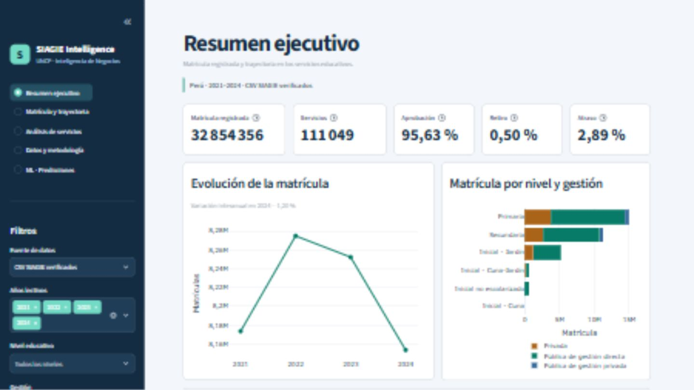

# SIAGIE Intelligence

Proyecto individual de Inteligencia de Negocios de la UNCP sobre matrícula y trayectoria estudiantil registrada en el SIAGIE 2021–2024. El dashboard opera localmente con CSV publicados por MINEDU y verificados con el manifiesto. [Fuente oficial y licencia de los datos](https://www.datosabiertos.gob.pe/dataset/matriculaci%C3%B3n-y-trayectoria-estudiantil-2021-2024).



Consulta el [plan por fases y el diagnóstico](docs/DIAGNOSTICO.md) y el [estado de implementación](docs/ESTADO_PROYECTO.md).

## Entorno local

Probado con Python 3.12.3 de 64 bits en Windows. Para obtener una copia desde GitHub:

```powershell
git clone https://github.com/ZairRaaa/siagie-intelligence.git
cd siagie-intelligence
```

Desde PowerShell, en la raíz del proyecto:

```powershell
python -m venv .venv
& .\.venv\Scripts\python.exe -m pip install -r requirements.txt
& .\.venv\Scripts\python.exe -m pip check
```

El archivo de dependencias incluye la base analítica y el dashboard descriptivo.

## Descargar los datos

```powershell
& .\.venv\Scripts\python.exe -X utf8 -m scripts.descargar_fuentes
```

El comando descarga un ZIP desde el [lanzamiento v1.0.0](https://github.com/ZairRaaa/siagie-intelligence/releases/tag/v1.0.0), verifica cada SHA-256 y coloca los cuatro CSV (unos 241 MB descomprimidos) en `contexto/`. Los CSV de MINEDU se distribuyen sin modificaciones y con la atribución indicada por la licencia [Open Data Commons Attribution](https://opendatacommons.org/licenses/by/1-0/).

Para usar un ZIP que ya descargaste, agrega `--zip <ruta-del-zip>`. También puedes descargar los cuatro CSV desde la [ficha de MINEDU](https://www.datosabiertos.gob.pe/dataset/matriculaci%C3%B3n-y-trayectoria-estudiantil-2021-2024), colocarlos en `contexto/` con sus nombres originales y ejecutar la verificación. Reserva aproximadamente 1 GB para datos y caché, además del entorno virtual.

## Ejecutar el dashboard

```powershell
& .\.venv\Scripts\python.exe -m streamlit run app.py
```

Abre [el dashboard local](http://127.0.0.1:8501). El selector de fuente arranca con **CSV SIAGIE verificados**. Puedes usar **DW_SIAGIE · SQL Server** cuando el certificado y los permisos de lectura estén configurados. Los filtros se aplican a las tablas, gráficos y descargas de cada vista.

La aplicación incluye Resumen ejecutivo, Matrícula y trayectoria, Análisis de servicios, Datos y metodología, y ML · Predicciones. Las descargas se generan en CSV UTF-8 con BOM. Para visualizar códigos con ceros iniciales en Excel, importa el archivo y define el código modular y el anexo como columnas de texto.

## Comprobar la fuente

El comando CSV comprueba la huella y el conteo de cada archivo antes de devolver filas y matrícula por año.

```powershell
& .\.venv\Scripts\python.exe -m scripts.verificar_origen --origen csv
```

Para SQL, se requiere ODBC Driver 17 for SQL Server y acceso de lectura a `DW_SIAGIE` con la cuenta de Windows. Crea `.env` desde la plantilla si el archivo aún no existe. Ajusta el servidor para tu equipo.

```powershell
if (-not (Test-Path -LiteralPath .env)) { Copy-Item .env.example .env }
& .\.venv\Scripts\python.exe -m scripts.verificar_origen --origen sql
```

En el equipo del proyecto, el conector devuelve SQLSTATE `08001` porque Windows no reconoce la cadena del certificado. La conexión requiere validar esa cadena y el nombre del servidor. El modo CSV funciona con las exportaciones conciliadas del proyecto.

## Evidencia

- [Salida de la verificación CSV desde Python](results/verificacion_origen_csv.json).
- [Lecturas SQL del diagnóstico](results/diagnostico_sql.txt).
- [Registro de comprobaciones](docs/PRUEBAS.md).

## Consultas filtradas

El [catálogo de indicadores](docs/INDICADORES.md) incluye las reglas y un ejemplo con los CSV reales. La primera consulta CSV verifica las huellas y construye una copia derivada de aproximadamente 418 MiB en `data/`. La copia se abre en solo lectura y se reutiliza mientras el manifiesto y la versión de normalización coincidan. SQL Server ejecuta los agregados mediante SELECT con parámetros enlazados y necesita acceso de lectura a `dw` y al catálogo de lotes `etl.Lote`.

```powershell
& .\.venv\Scripts\python.exe -m pytest -q
```

El registro de comprobaciones describe cómo reproducir la conciliación entre los dos orígenes.

## Machine Learning

Para reproducir la evaluación histórica desde los CSV verificados:

```powershell
& .\.venv\Scripts\python.exe -X utf8 -m scripts.preparar_panel_ml --solo-csv
& .\.venv\Scripts\python.exe -X utf8 -m scripts.entrenar_matricula
```

La preparación coteja el panel y los Parquet regenerados contra las huellas de la ejecución conciliada con SQL Server. El entrenamiento genera sus artefactos locales. Al abrir **ML · Predicciones** se muestra la evaluación histórica 2023→2024. Una ejecución completada se reutiliza al repetir el comando.

Para auditar el resultado y exportar el gráfico:

```powershell
& .\.venv\Scripts\python.exe -X utf8 -m scripts.verificar_ejecucion_ml --figura
```

[Protocolo y reproducción](docs/MACHINE_LEARNING.md) · [Resultados](docs/RESULTADOS.md) · [Evidencias](docs/MANIFIESTO_EVIDENCIAS.md).

## Asistente GPT opcional

En el Resumen ejecutivo, **Asistente GPT** explica el corte, compara años o prepara notas para exponer. En **ML · Predicciones** interpreta las métricas de la evaluación histórica. La generación se activa al pulsar el botón. [Configuración y datos enviados](docs/ASISTENTE_GPT.md).

