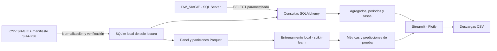

# Arquitectura de SIAGIE Intelligence

Aplicación local en Windows con Python 3.12, Streamlit y Plotly. La interfaz usa el mismo contrato de filtros e indicadores para ambas fuentes.

| Componente | Responsabilidad |
|---|---|
| `app.py` | Navegación, selección explícita de fuente, filtros y avisos de conexión. |
| `src/data/` | Conexión SQLAlchemy/PyODBC, normalización CSV, copia SQLite versionada, consultas parametrizadas y caché. |
| `src/analytics/` | Indicadores, disponibilidad temporal y variación entre años consecutivos. |
| `src/ml/`, `scripts/entrenar_matricula.py` | Particiones temporales, pipelines, selección y evaluación fuera de la interfaz. |
| `src/ui/` | Páginas, gráficos Plotly, tablas y exportaciones. |
| `tests/` | Verificación de semántica y de flujos Streamlit con las fuentes reales. |
| `contexto/`, `results/`, `evidence/` | Referencias HEFESTO, conciliaciones y evidencia de ejecución. |

La agregación se ejecuta en el motor correspondiente. El listado de servicios devuelve hasta 100 agrupaciones de un año. La búsqueda retorna hasta 60 claves. La distribución de tasas se agrupa en el motor para toda la selección y distingue denominadores menores de 10. La interfaz reutiliza los catálogos pequeños de filtros durante cinco minutos. La base y las fuentes originales se consultan mediante lecturas.

El modo CSV abre la copia derivada de los archivos originales. El modo SQL se configura con autenticación de Windows y validación TLS. La interfaz muestra un aviso si la conexión falla y conserva el selector de fuente para cambiar a CSV. El servidor escucha en `127.0.0.1`.

La página predictiva lee el resultado publicado por el comando de entrenamiento. Mantiene disponible el protocolo cuando la ejecución aún está pendiente.
